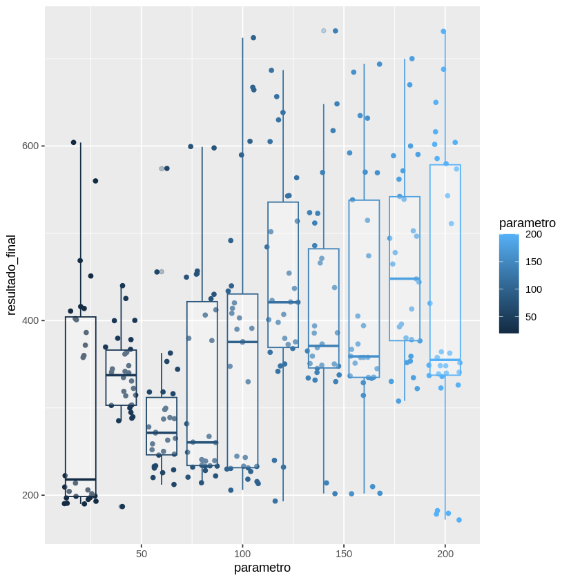
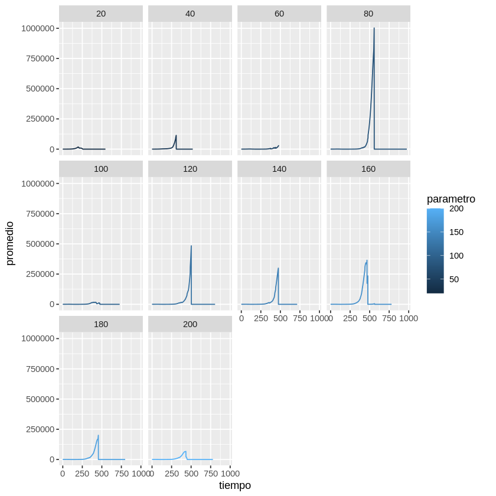

# Wolf Sheep Predation: efecto del número inicial de ovejas

Análisis experimental del modelo **Wolf Sheep Predation** de NetLogo, replicando la metodología de
Helechos Básico: diseño de experimentos en **BehaviorSpace**, exportación de datos a CSV y análisis
en **R** con `tidyverse` y `ggplot2` desde notebooks de Colab.

**Curso:** Teoría de la Computación
**Autor:** Juan David Rodríguez Franco
**Repositorio:** https://github.com/juandrodriguezf/wolf-sheep-predation-netlogo

<p>
  
  
  
  
  
</p>

---

**Contenido:** [Pregunta](#pregunta-experimental) · [Modelo](#modelo) · [Repositorio](#contenido-del-repositorio) · [Diseño](#diseño-experimental) · [Resultados](#resultados-principales) · [Figuras](#resultados-visuales) · [Datos](#datos) · [Reproducción](#cómo-reproducir) · [Licencia](#licencia-y-atribución) · [Citación](#cómo-citar) · [Material](#material-complementario)

## Pregunta experimental

¿Cómo afecta el número inicial de ovejas (`initial-number-sheep`) al tiempo de duración de la
simulación (`ticks`) y a la dinámica temporal de la población de ovejas (`count sheep`)?

---

## Modelo

El modelo representa un ecosistema depredador-presa en la variante **`sheep-wolves` (sin pasto)**, que es la que abre por defecto:

- **Ovejas (presas):** se mueven y se reproducen con una probabilidad fija por tick.
- **Lobos (depredadores):** se mueven, cazan ovejas para obtener energía y se reproducen.

No hay pasto: las ovejas solo mueren cuando un lobo las caza. Los lobos pierden energía al moverse y mueren cuando su energía llega a cero. La simulación termina cuando no quedan turtles o cuando no quedan lobos y `count sheep > max-sheep` (30.000 en NetLogo de escritorio).

---

## Contenido del repositorio

```
wolf_sheep/
  Wolf Sheep Predation.nlogox   Modelo de NetLogo 7 (experimentos configurados en BehaviorSpace)
  wolfsheep_final.csv           Resultados finales: una fila por corrida (296 corridas)
  wolfsheep_evol.csv            Resultados por tick: una fila por corrida y tick
  WolfSheep_PostMortem.ipynb    Análisis final: dispersión, jitter y boxplot
  WolfSheep_Evolutivo.ipynb     Análisis temporal: promedios y facetas
  WolfSheep_Informe.md          Informe completo del proyecto
```

El video de sustentación y el material de referencia del curso no se incluyen en el repositorio.

Los experimentos de BehaviorSpace no están guardados dentro del `.nlogox`: se distribuyen como XML importable en [`docs/experimentos/wolfsheep_experiments.xml`](docs/experimentos/wolfsheep_experiments.xml). La configuración exacta está en [`docs/reproduccion.md`](docs/reproduccion.md).

---

## Diseño experimental

| Elemento | Valor |
| --- | --- |
| Variante del modelo | `sheep-wolves` (sin pasto) |
| Parámetro independiente | `initial-number-sheep` |
| Valores probados | 20, 40, 60, 80, 100, 120, 140, 160, 180, 200 |
| Repeticiones | 30 por valor (296 corridas válidas) |
| Métrica final | `ticks` |
| Métrica temporal | `count sheep` |
| Condición de parada | (1) no quedan turtles; (2) no quedan lobos y `count sheep > max-sheep` (30.000) |
| Experimento final | `wolfsheep_final` (sin métricas por paso) |
| Experimento evolutivo | `wolfsheep_evol` (métricas cada paso) |
| NetLogo | 7.0.4 |

`initial-number-wolves` se mantuvo en su valor predeterminado. Los experimentos de BehaviorSpace no
quedaron guardados dentro del `.nlogox`; su configuración se documenta en la sección
[Cómo reproducir](#cómo-reproducir).

---

## Resultados principales

Resumen de `ticks` por valor inicial (datos de `wolfsheep_final.csv`):

| Ovejas iniciales | Corridas | Min | Mediana | Media | Max |
| ---: | ---: | ---: | ---: | ---: | ---: |
| 20 | 28 | 190 | 218 | 307.6 | 604 |
| 40 | 30 | 187 | 338 | 336.4 | 440 |
| 60 | 30 | 212 | 272 | 289.7 | 574 |
| 80 | 30 | 214 | 260 | 325.7 | 599 |
| 100 | 30 | 206 | 376 | 373.2 | 724 |
| 120 | 30 | 193 | 421 | 443.2 | 687 |
| 140 | 30 | 202 | 371 | 415.1 | 732 |
| 160 | 29 | 202 | 359 | 419.7 | 694 |
| 180 | 29 | 308 | 448 | 461.7 | 700 |
| 200 | 30 | 172 | 355 | 421.3 | 731 |

- La duración media más baja aparece con **60 ovejas** (289.7 ticks) y la más alta con **180** (461.7).
- La relación **no es monótona**: hay alta variabilidad entre repeticiones y los rangos se superponen.
- A partir de 100 ovejas la media tiende a estabilizarse alrededor de 415–460 ticks, con casos que
  superan los 700 ticks.
- El análisis evolutivo muestra que la población no decrece de forma simple: **crece, alcanza un pico y
  colapsa**. En algunas corridas los lobos se extinguen y las ovejas se desbordan (máximo observado:
  3.390.767).
- Cada corrida termina en **colapso** (ovejas = 0) o en **desborde** (ovejas > 30.000 tras extinguirse
  los lobos). La proporción de cada desenlace cambia con el parámetro y explica la no monotonía de
  `ticks`; el desglose está en el informe.

La interpretación completa está en [`WolfSheep_Informe.md`](wolf_sheep/WolfSheep_Informe.md) y en las
celdas de conclusión de cada notebook.

---

## Resultados visuales

<p align="center">
  
</p>

*Distribución de `ticks` por valor inicial de ovejas. Cada punto es una corrida; la caja resume la mediana y los cuartiles.*

<p align="center">
  
</p>

*Promedio de `count sheep` por paso para cada valor de `initial-number-sheep`. La escala temporal es `[step]`.*

También están disponibles la [dispersión completa](docs/figuras/ticks-jitter.png) y las [líneas sin facetas](docs/figuras/evolucion-lineas.png).

---

## Datos

| Archivo | Filas de datos | Corridas | Métrica |
| --- | ---: | ---: | --- |
| [`wolfsheep_final.csv`](wolf_sheep/wolfsheep_final.csv) | 296 | 296 | `ticks` |
| [`wolfsheep_evol.csv`](wolf_sheep/wolfsheep_evol.csv) | 116.469 | 300 | `count sheep` |

El CSV final conserva 296 de las 300 corridas planificadas (faltan 19, 58, 71 y 271). El diccionario de columnas, los conteos por grupo y las condiciones de parada están en [`docs/datos.md`](docs/datos.md).

---

## Cómo reproducir

1. Abrir el modelo en NetLogo 7.0.4.
2. Crear en BehaviorSpace los dos experimentos con esta configuración:

```
Experimento final (wolfsheep_final)
  Setup commands:
    set model-version "sheep-wolves"
    setup
  Go commands: go
  Vary variable: initial-number-sheep = 20, step 20, last 200
  Repetitions: 30
  Run metrics every step: No
  Measure runs using: ticks
  Stop condition: natural del modelo

Experimento evolutivo (wolfsheep_evol)
  Setup commands:
    set model-version "sheep-wolves"
    setup
  Go commands: go
  Vary variable: initial-number-sheep = 20, step 20, last 200
  Repetitions: 30
  Run metrics every step: Yes
  Measure runs using: count sheep
  Stop condition: natural del modelo
```

La configuración exacta, incluyendo `exitCondition ticks >= 1000`, está en [`docs/reproduccion.md`](docs/reproduccion.md). También puedes importar los experimentos desde [`docs/experimentos/wolfsheep_experiments.xml`](docs/experimentos/wolfsheep_experiments.xml) en lugar de crearlos a mano.

`wolfsheep_final` registra solo `ticks`; `wolfsheep_evol` registra `count sheep` en cada paso y usa `[step]` como tiempo.

3. Exportar los resultados como CSV de tabla y reemplazar los archivos de `wolf_sheep/`.
4. Abrir los notebooks en Colab (kernel R) y ejecutar todas las celdas.

[](https://colab.research.google.com/github/juandrodriguezf/wolf-sheep-predation-netlogo/blob/master/wolf_sheep/WolfSheep_PostMortem.ipynb)
[](https://colab.research.google.com/github/juandrodriguezf/wolf-sheep-predation-netlogo/blob/master/wolf_sheep/WolfSheep_Evolutivo.ipynb)

Los notebooks leen los CSV directamente desde la rama `master` mediante URLs raw de GitHub.

---

## Reproducibilidad y experimentos

La guía completa, los comandos de NetLogo headless y las limitaciones están en [`docs/reproduccion.md`](docs/reproduccion.md). El entorno R se instala con [`requirements.R`](requirements.R).

- [`docs/experimentos/wolfsheep_experiments.xml`](docs/experimentos/wolfsheep_experiments.xml) contiene los dos experimentos listos para importar en BehaviorSpace.
- `wolfsheep_final`: 30 repeticiones, métrica `ticks`, sin registro por paso.
- `wolfsheep_evol`: 30 repeticiones, métrica `count sheep`, registro en cada paso.
- Ambos varían `initial-number-sheep` de 20 a 200 en pasos de 20 y usan `exitCondition ticks >= 1000`.
- Los experimentos originales no fijaron `random-seed`; por eso se reproduce la metodología, no cada valor numérico.

---

## Licencia y atribución

- Código y notebooks originales: [MIT](LICENSE).
- Datos, figuras e informe originales: [CC BY 4.0](LICENSE-DATA).
- Modelo NetLogo `Wolf Sheep Predation`: Copyright 1997 Uri Wilensky, [CC BY-NC-SA 3.0](https://creativecommons.org/licenses/by-nc-sa/3.0/). No se relicencia bajo MIT ni CC BY 4.0.
- NetLogo: software libre para uso no comercial bajo GNU GPL.

Consulta [`NOTICE.md`](NOTICE.md) para la atribución completa y las citas del modelo.

---

## Cómo citar

Los metadatos de citación están en [`CITATION.cff`](CITATION.cff).

```bibtex
@software{rodriguez_franco_wolf_sheep_2026,
  author  = {Rodríguez Franco, Juan David},
  title   = {Wolf Sheep Predation: efecto del número inicial de ovejas en la dinámica depredador-presa},
  year    = {2026},
  version = {1.0.0},
  url     = {https://github.com/juandrodriguezf/wolf-sheep-predation-netlogo},
  license = {MIT}
}
```

Si reutilizas el modelo original, cita también:

> Wilensky, U. (1997). NetLogo Wolf Sheep Predation model. http://ccl.northwestern.edu/netlogo/models/WolfSheepPredation. Center for Connected Learning and Computer-Based Modeling, Northwestern University, Evanston, IL.

---

## Material complementario

```text
docs/
  datos.md
  reproduccion.md
  experimentos/wolfsheep_experiments.xml
  figuras/
    ticks-jitter.png
    ticks-boxplot.png
    evolucion-lineas.png
    evolucion-facetas.png
LICENSE
LICENSE-DATA
NOTICE.md
CITATION.cff
requirements.R
```

- [Informe completo](wolf_sheep/WolfSheep_Informe.md)
- [Diccionario de datos](docs/datos.md)
- [Guía de reproducción](docs/reproduccion.md)
- [Experimentos importables](docs/experimentos/wolfsheep_experiments.xml)
- [Licencia del código](LICENSE)
- [Licencia de datos](LICENSE-DATA)
- [Atribución y licencias de terceros](NOTICE.md)
- [Metadatos de citación](CITATION.cff)
